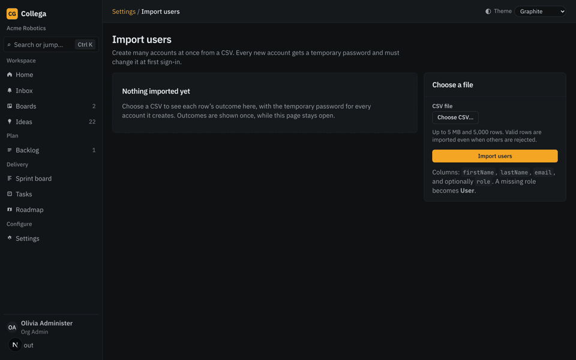
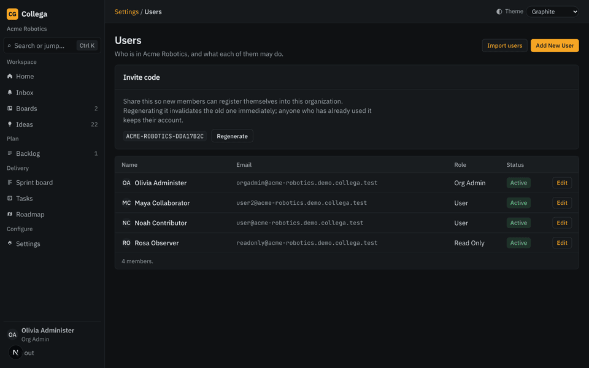
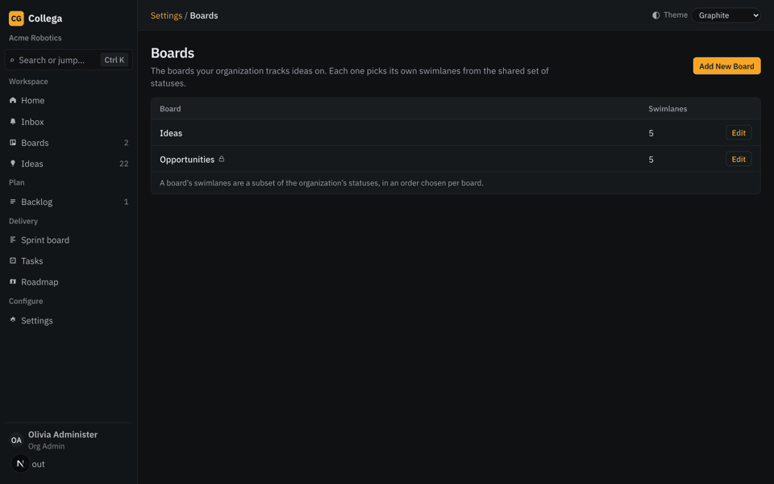
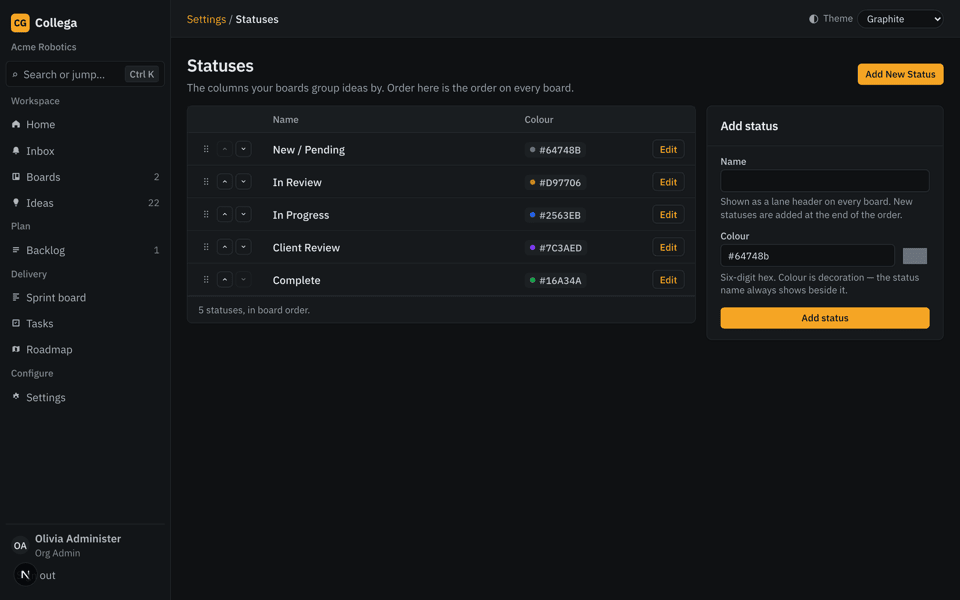
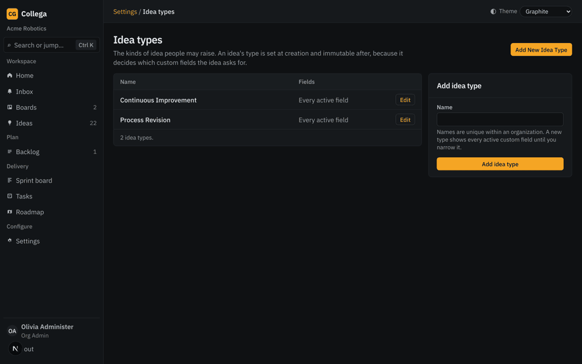
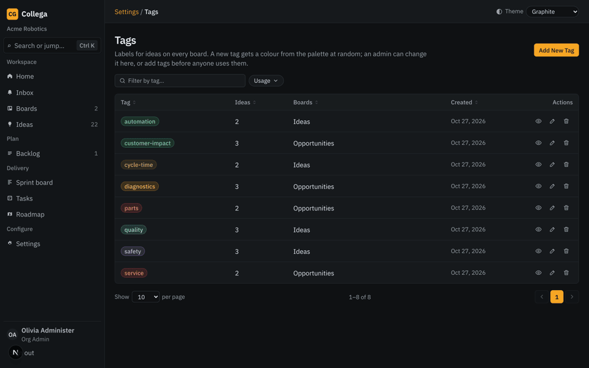
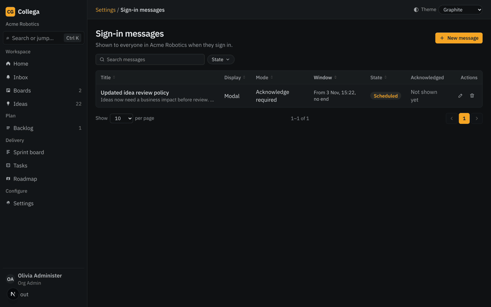

# Collega Org Admin Guide

This guide covers organization-level administration. It does not document platform-wide or
Site Admin-only operations. For everyday work and Read Only permissions, see the
[User Guide](user-guide.md).

> **About the illustrations:** The screenshots below come from Collega's clickable prototype. They
> are visual references, not guaranteed captures of the version deployed to your organization.
> Follow the labels in your app if they differ.

## Your administration scope

An Org Admin manages users, boards, and settings for their own organization. The **Settings** hub
shows the areas available to your role. Some settings are visible to all organization members but
can only be changed by an Org Admin.

Your profile remains separate from organization settings. Use **Settings → My profile** to update
your own name, password, and usage-recording preference.

## Manage users and invite people

Open **Settings → Users** to view your organization's members and invite code.

### Add one user

1. Choose **Add New User**.
2. Enter first name, last name, email, role, and an initial password.
3. Save, then provide the person their sign-in details securely. They must change the initial
   password at first sign-in.

Organization roles are **Org Admin**, **User**, and **Read Only**. Use Read Only for people who
should be able to view, follow, comment, and upvote without editing ideas or scheduling tasks.

### Import users from CSV

1. Choose **Import users** from the Users screen.
2. Upload a CSV with `firstName`, `lastName`, and `email` columns. The optional `role` column
   defaults to **User** when omitted.
3. Submit the file and review the result for each row. Valid rows are created even when other rows
   are rejected.
4. Copy each generated temporary password before leaving or reloading the results page. It is
   shown once, and each imported user must change it at first sign-in.

The importer accepts up to 5 MB and 5,000 rows. Correct rejected rows and import them again if
needed.

### Edit or deactivate an account

Open a person from the Users list to edit their name, email, role, or status. **Inactive** accounts
cannot sign in, but their existing ideas and comments remain attributed to them. Deactivation is
not deletion. Keep at least one active Org Admin in the organization; the last Org Admin cannot
remove their own ability to administer it.

### Share or regenerate the invite code

Share the invite code shown on the Users screen when people should self-register as Users. If you
regenerate the code, the previous code stops working immediately. People who already registered
are unaffected.

## Configure boards and access

Use **Settings → Boards** to create or edit a board. Choose its name, description, and the statuses
that become its swimlanes; reorder lanes for the board's workflow. A board needs at least two
swimlanes. A board can also limit which active Idea types are offered on it.

Boards are archived rather than deleted. An archived board remains readable but cannot accept new
ideas or be edited until it is unarchived. When removing a lane that still contains ideas, choose
which remaining lane those ideas should move to before saving.

### Restrict a board

In the board form's **Access** section:

1. Change visibility from **Organization** to **Restricted**.
2. Select the people and groups who should be able to see the board.
3. Save the board.

An Org Admin can always see every board in the organization. A board's creator can also see it;
other people need a direct grant or membership in a granted group. An empty access list therefore
leaves the board visible only to the Org Admin and its creator. Access is visibility, not a change
to a person's role or editing permissions. Check the access list before removing a group or a
person, because that can remove their access to every board granted to them that way.

### Manage groups

Open **Settings → Groups** to create and maintain named groups. Add organization members to a
group, then grant that group access in a Restricted board's Access section. Everyone in the
organization can view the group list; only Org Admins can create, edit, or delete groups. Deleting
a group removes its board grants, but does not delete its members.

## Configure statuses and idea fields

### Statuses

Open **Settings → Statuses** to add, rename, recolor, and reorder the organization's shared
statuses. Boards choose their own subset and lane order. Keep at least two active statuses. A
status used by a board cannot be deleted until it is no longer used as a lane; removing a lane with
ideas requires choosing a destination lane.

### Idea types, custom fields, and fieldsets

Use **Settings → Idea Types** to manage the active types offered when people create ideas. Types
can have a color and icon, and can be configured to show all active custom fields or a selected
set. A type's field selection can include individual fields and reusable fieldsets. Required fields
must be completed before an idea can be saved.

Use **Settings → Custom Fields** to create and maintain organization-wide fields. Available field
types include text, number, date, boolean, dropdown, multi-select, and URL. Use **Settings →
Fieldsets** to group fields that should be reused together. Fields are shared across the
organization; a type controls which ones appear on its idea form.

An idea's type is normally fixed after creation. An Org Admin can use the dedicated type-reassign
action to correct an existing idea; check the resulting field set and values before saving.

### Tags

Open **Settings → Tags** to add tags in advance, filter by name or usage, change a tag's color, or
remove an unused or obsolete tag. People who can edit ideas can also create a tag while editing an
idea. Tag names are organization-wide and matched without regard to case. Deleting a tag removes it
from the ideas that use it; the confirmation shows how many ideas are affected.

## Help your organization plan work

Collega has two related but distinct planning areas:

- **Board Backlogs and Sprints** manage tasks and standalone work cards on a particular work board.
  Org Admins can create, edit, start, and complete that board's sprints, and can schedule any task
  they are allowed to manage. Users can schedule tasks they authored, but cannot create, start, or
  complete sprints.
- **Delivery → Backlog and Sprint board** manage Issues and organization delivery sprints. Issues
  are ideas in the delivery workflow. From the Delivery Backlog, choose **Add New Issue** to create
  one directly; Effort is required and a Planned or Active sprint is optional. The Issue drawer
  retains its idea context and checklist tasks.

Create a sprint with a name and a valid date range. Add Issues or board tasks to the appropriate
sprint. Starting a delivery sprint makes it active. Completing it returns unfinished Issues to
the Delivery Backlog; it does not delete them. The Roadmap currently shows sprint dates and
supports Weeks, Months, and Quarters zoom. Outcome grouping is not available yet.

## Sign-in messages and AI usage

### Sign-in messages

Open **Settings → Sign-in messages** to publish a notice to everyone in your organization. Set a
title, message, start date, optional end date, display style (modal or banner), and dismissal
behavior:

- **Every sign-in:** closing hides it for the current sign-in only.
- **Dismiss once:** dismissing stops it from appearing again.
- **Acknowledge required:** the person must acknowledge it to dismiss it permanently; closing only
  hides it until their next sign-in.

The message appears after authentication, not on the sign-in page. The acknowledgement report
shows who acknowledged an acknowledgment-required message and when. Editing a message does not
automatically show it again to everyone; use **Show again to everyone** when that is intended.

### API usage

**Settings → API usage** is read-only. It shows today's Idea Assistant conversations, token counts,
and estimated cost for your organization. Estimated cost is informational, not an invoice. This
screen does not show or manage the deployment-wide budget.

Usage recording can be turned off by each person from their own profile; an Org Admin cannot
change that preference for someone else. The Org Admin's **AI Assist** scope-statement screen is
not currently wired to save changes, so do not rely on its Save or Clear controls to change the
assistant's behavior.

## Administration checklist

- Keep at least one active Org Admin and review user roles before sharing invite codes.
- Check Restricted-board access after changing group membership or deleting a group.
- Confirm lane destinations before removing lanes that still contain ideas.
- Copy imported temporary passwords before leaving the results page.
- Use sign-in message dismissal modes deliberately: closing an acknowledgment-required message is
  not the same as acknowledging it.
