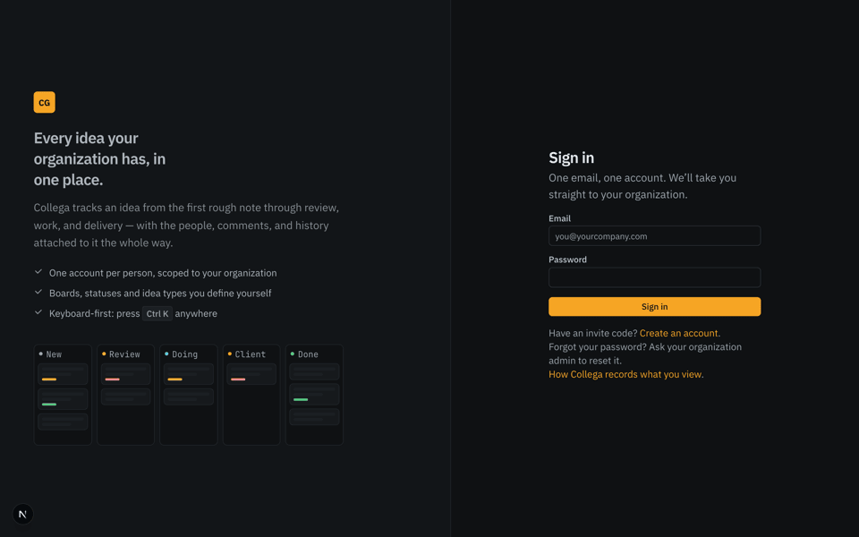
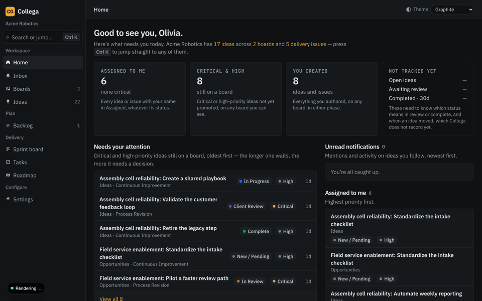
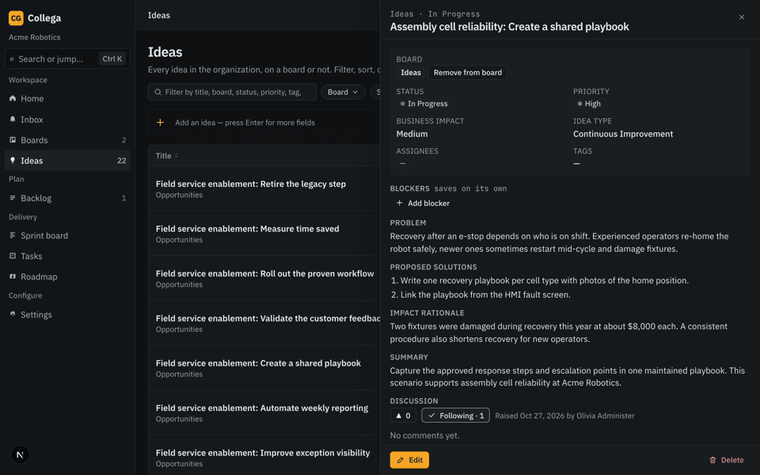
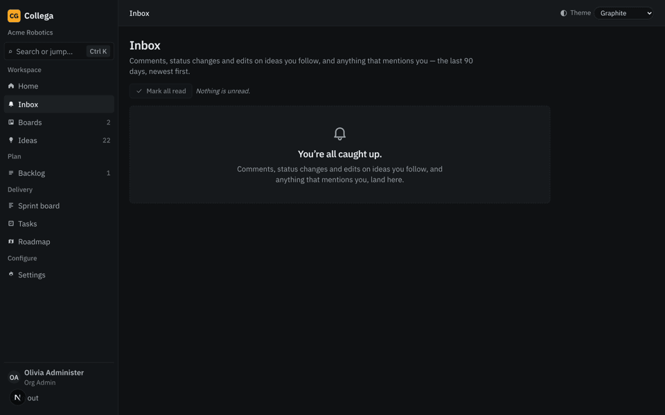
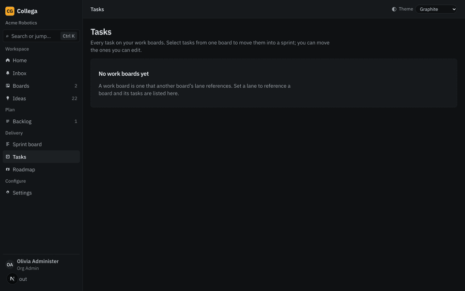

# Collega User Guide

This guide covers day-to-day work in Collega for **User** and **Read Only** accounts. Your
organization's settings and membership are managed by its Org Admin; see the
[Org Admin Guide](org-admin-guide.md).

> **About the illustrations:** The screenshots below come from Collega's clickable prototype. They
> are visual references, not guaranteed captures of the version deployed to your organization.
> Follow the labels in your app if they differ.

## Sign in and get started

1. Open the Collega address provided by your organization and sign in with your email and password.
2. If an Org Admin created your account or imported it from a CSV, change the initial or temporary
   password when prompted, then sign in again with the new password.
3. If you are joining with an invite code, choose **Register** and enter the code and your account
   details. An invite code is tied to one organization. Registration creates a **User** account;
   ask an Org Admin if you need a different role.

If Collega sends you back to sign-in, your session may have expired. Sign in again. Your password
can be changed later from **Settings → My profile**; after changing it, sign in again with the new
password.

## Find your work

Use the sidebar to open **Home**, **Inbox**, **Boards**, **Ideas**, **Backlog**, **Sprint board**,
**Tasks**, and **Roadmap**. The command palette can jump to a screen without browsing the sidebar.
Use the theme picker to change the appearance; your choice is remembered in that browser.

On list pages, use the search box, filters, column sorting, and pager to narrow the results. The
Ideas list can search across idea details and visible metadata, including board, status, priority,
tags, and people. Opening an idea brings up its detail drawer; the URL can be bookmarked or shared
with another person who has permission to see that idea.

Users can create a board from the **Boards** list. Enter a name, optionally add a description, and
choose at least two statuses for its lanes. Org Admins manage board settings after creation.

## Work with boards and ideas

Open **Boards**, choose a board, and select **New idea** to add an idea there. Complete the required
fields:

- **Title**, **Problem**, at least one **Proposed solution**, and **Impact rationale**
- **Priority**, **Idea type**, and **Business impact**

Add an optional summary, due date, assignees, tags, or custom fields when they apply. An idea can
have up to five assignees and ten tags. The fields shown can depend on the selected Idea type.
Review the form and save; a successful save closes the drawer and returns you to the board.

If **Idea assistant** is available, describe the problem or your proposed change in the assistant.
It can suggest content for the form, but it does not submit an idea. Review and edit every
suggestion, or choose **Fill out manually**, then save the form yourself. If the assistant is
unavailable, use the regular form.

Open an idea to update the fields you are allowed to edit. The author and Org Admin can edit the
structured problem, proposed solutions, impact rationale, and summary; other idea fields may have
their own permission limits. Idea type is chosen when the idea is created and cannot normally be
changed afterward. Move an idea between the board's lanes by dragging its card or changing its
status in the detail drawer.

## Collaborate on an idea

- **Comment:** Add a comment in the idea drawer. Comments are plain text. You can edit or delete
  your own comments.
- **Mention:** Type `@` and choose a person from the suggestions. Selecting a suggestion creates a
  mention notification; typing a name without selecting a suggestion is just text.
- **Upvote:** Use the upvote control to add or remove your vote.
- **Follow:** Choose **Follow** on an idea to receive its relevant activity in your Inbox. Following
  does not change who can see or edit the idea. Authors and assignees follow automatically, and can
  unfollow if they choose.

The **Inbox** contains in-app notifications for ideas you follow and mentions sent to you. Open an
Inbox row to view the idea; mark items individually or use **Mark all read**. Collega's Inbox is not
email, and opening an idea outside the Inbox does not mark its notification as read.

## Read Only participation

Read Only accounts can view the boards and ideas they can access, follow or unfollow ideas, comment,
and upvote. They cannot create or edit ideas, move cards, create tags, manage groups, or schedule
tasks. A control that is unavailable to your role may be hidden or show why it is disabled.

## Tasks, backlogs, and sprints

Collega has two different kinds of work list:

| Screen | What it contains |
|---|---|
| A board's **Backlog** | Tasks and standalone work cards for that board that are not in a sprint |
| **Delivery → Backlog** | Issues that have been committed for delivery but are not in a delivery sprint |

### Board tasks

Open a work board and choose **Backlog** to find its unscheduled tasks. Users and Org Admins can
choose **New task** and enter a title. Optionally add a parent idea, description, assignees, or tags;
no parent means the task is standalone. The **Tasks** page shows tasks across boards; use its tabs
to switch among Backlog, My tasks, In sprint, and All.

You can schedule tasks you authored into a Planned or Active sprint on the same board. An Org Admin
can also schedule tasks created by other people. Select tasks and use the action bar, or open a
sprint's planning page to add or remove tasks. A User cannot create, start, or complete a sprint;
those actions belong to Org Admins. Read Only accounts can view tasks but cannot create or schedule
them.

### Issues and delivery sprints

Issues are ideas in the delivery workflow. From **Delivery → Backlog**, an authorized person can
choose **Add New Issue** to create an Issue directly; Effort is required, and a sprint is optional.
The Issue drawer keeps the idea's context and history with the delivery work. Issues move through
the delivery statuses **Pending**, **Scoping**, **Development**, **Review**, and **Complete**.

An Org Admin creates, starts, and completes delivery sprints. When a sprint is completed,
unfinished Issues return to the Delivery Backlog. The **Sprint board** shows the active or next
planned delivery sprint; eligible authors, assignees, and Org Admins can update an Issue's delivery
status.

**Roadmap** displays delivery sprints on a timeline. Choose Weeks, Months, or Quarters to change
the zoom. Outcome grouping and management are not available yet, so the Roadmap currently shows
sprints rather than Outcome plans.

## Messages and profile settings

An Org Admin may post a sign-in message for everyone in your organization. Active messages appear
on the first page after sign-in. Depending on the message, **Close** may show it again next time;
**Dismiss** or **Acknowledge** records a lasting response for that message. Read the message's
controls before closing it.

From **Settings → My profile**, you can change your name, change your password, and choose whether
Collega records your usage. Turning usage recording off stops new usage events for your account;
it does not erase events already recorded. Your email and role are read-only on your profile.

## If something is missing

- A board or idea may be restricted to selected people or groups. Ask your Org Admin to check your
  access.
- A **Not found** page can mean the item was removed, archived, or is not visible to your account.
- If an action is disabled, check its explanation or contact your Org Admin. Read Only accounts
  cannot edit content or schedule work.
- If a sign-in message requires acknowledgment, acknowledge it to stop it appearing again. Closing
  an acknowledgment-required message only hides it until the next sign-in.
